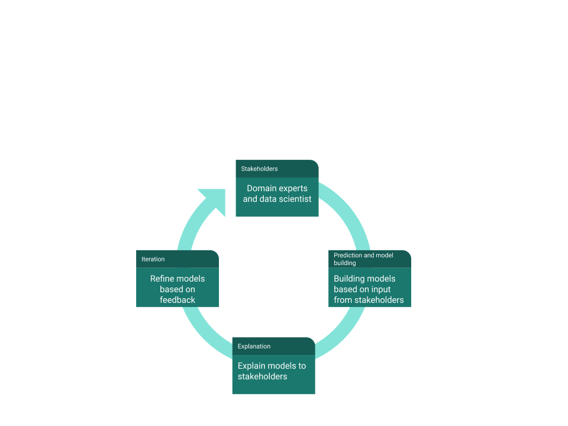

# 👋 Hello, I am Soumya Banerjee! (pronounced show-mo)

🎓 **Assistant Research Professor**  
🌍 University of Cambridge

---

## 🚀 About Me

I tackle complex problems and create new statistical and machine learning techniques to extract insights from large datasets. My work lies at the fascinating intersection of **complex systems** and **explainable AI**.

I have worn many hats:  

💼 AI/Machine Learning researcher

🔬 Experimental scientist  

🏥 Data scientist in a clinical setting

🏥 Computational biologist

💼 Teaching AI techniques

💼 Developing new AI techniques

💼 Finance & industry professional (domain certified in finance & mortgage)  

---

## 🛠️ What I Do

- 🔭 Analyze complex systems with data science and ML  
- 🌱 Research areas:  
  - Data Science, Machine Learning  
  - Computational Biology, Bioinformatics  
  - Computational Immunology & Immunogenomics  
  - Clinical Informatics

---

## 📬 Get in Touch / More About Me

- 🌐 [Personal website](https://sites.google.com/site/neelsoumya)
- 📄 [Publications](https://sites.google.com/site/neelsoumya/publications)
- 🎥 [Research video](https://www.youtube.com/watch?v=vLl4nu6Dmgk)
- 💻 [Software](https://sites.google.com/site/neelsoumya/software)
- 💻 [CV](https://github.com/neelsoumya/CV/blob/master/CV_SoumyaBanerjee.pdf)
- 🌐 [Yet another webpage](https://neelsoumya.github.io/)

---

## 📦 Featured R Packages

- [dsSurvival](https://github.com/neelsoumya/dsSurvival)
- [dsSurvivalClient](https://github.com/neelsoumya/dsSurvivalClient)
- [dsSurvivalbookdown](https://neelsoumya.github.io/dsSurvivalbookdown/)

#### 🛠️ More Packages

- [dsMiscellaneous](https://github.com/neelsoumya/dsMiscellaneous)  
- [rlib](https://github.com/neelsoumya/rlib)  
- [dsSyntheticClient](https://github.com/neelsoumya/dsSyntheticClient)  
- [dsSynthetic-1](https://github.com/neelsoumya/dsSynthetic-1)  
- [meditator](https://github.com/neelsoumya/meditator)  
- [ShinyDataSHIELD](https://github.com/neelsoumya/ShinyDataSHIELD)

---

## 🌟 Outreach Projects

- [outreach_ppi](https://github.com/neelsoumya/outreach_ppi)
- [ai_outreach](https://github.com/neelsoumya/ai_outreach)
- [deep_dali](https://github.com/neelsoumya/deep_dali)
- [ramanujan_number_generator](https://github.com/neelsoumya/ramanujan_number_generator)

---

## 👨‍🏫 Teaching Resources

- [Teaching site](https://sites.google.com/site/neelsoumya/teaching)
- [Teaching collated](https://neelsoumya.github.io/teaching_collated/)
- [butterfly_detector](https://github.com/neelsoumya/butterfly_detector)
- [basic_statistics](https://github.com/neelsoumya/basic_statistics)
- [teaching_resources](https://github.com/neelsoumya/teaching_resources)
- [getting-_started_data_science](https://github.com/neelsoumya/getting-_started_data_science)
- [bioinformatics_resources](https://github.com/neelsoumya/bioinformatics_resources)
- [intro-machine-learning](https://github.com/neelsoumya/intro-machine-learning)
- [special_topics_unconventional_AI](https://github.com/neelsoumya/special_topics_unconventional_AI)
- [visualization_lecture](https://github.com/neelsoumya/visualization_lecture)
- [intro_to_LMMs](https://github.com/neelsoumya/intro_to_LMMs)  
- 🎥 [Teaching demo videos](https://www.youtube.com/watch?v=omxbpel-b64&feature=youtu.be)  
- 📚 [Collected resources (OSF)](https://osf.io/25gnz/)

---

## 🎤 Talks

- [YouTube Talk Playlist](https://www.youtube.com/watch?v=jDIt60LVyWY&list=PL_3n--M9GNtBevpfzHkelrRj03wVjAU0Q)
- [Featured Talk 1](https://www.youtube.com/watch?v=omxbpel-b64&feature=youtu.be)
- [Featured Talk 2](https://www.youtube.com/watch?v=4_la9-Ehvmo)

---

## 💻 Software & Portfolio

- [My open-source portfolio](https://github.com/neelsoumya/public_open_source_data_science)
- [Software by my students](https://github.com/neelsoumya/complex_stories_explanations)  
  [patient_stratification_explainable_AI](https://github.com/neelsoumya/patient_stratification_explainable_AI)  
  [arckit](https://github.com/mxbi/arckit)

---

## 🎛️ Graphical User Interfaces

- [meditator](https://sb2333medschl.shinyapps.io/meditator/)
- [cosmic_loneliness](https://sb2333medschl.shinyapps.io/cosmic_loneliness/)
- [accident_prediction](https://neelsoumya.shinyapps.io/accident_prediction/)
- [drake_shiny](https://sb2333medschl.shinyapps.io/drake_shiny/)

---

## ✨ Preprints

- [GitHub preprints](https://github.com/neelsoumya/paper_preprints)
- [Bitbucket preprints](https://bitbucket.org/neelsoumya/paper_preprints)

---

## 🌐 Online Presence

- 💻 [Website](https://sites.google.com/site/neelsoumya)
- 🎥 [YouTube Channel](https://www.youtube.com/channel/UCaEa-gedhvk0AUjEUjcNsmw)
- 🌟 [Patreon](https://www.patreon.com/soumyabanerjee)

---

## 🧭 My Philosophy

👥 I collaborate closely with domain experts and stakeholders, using computational tools for social good.

---

<!--
**neelsoumya/neelsoumya** is a ✨ _special_ ✨ repository because its `README.md` (this file) appears on your GitHub profile.

My name is Soumya Banerjee (first name pronounced as show-mo) and I am a researcher.

I analyze complex problems and implement new statistical and machine learning techniques for deriving insights from large amounts of data.

I have worked in financial and healthcare domains and am domain certified in finance and mortgage.

Here are some ideas to get you started:

- 🔭 I’m currently working on analyzing complex problems and implementing new statistical and machine learning techniques for deriving insights from large amounts of data
- 🌱 I’m currently learning ...
- 👯 I’m looking to collaborate on ...
- 🤔 I’m looking for help with ...
- 💬 Ask me about ...
- ⚡ Fun fact: ...
-->
